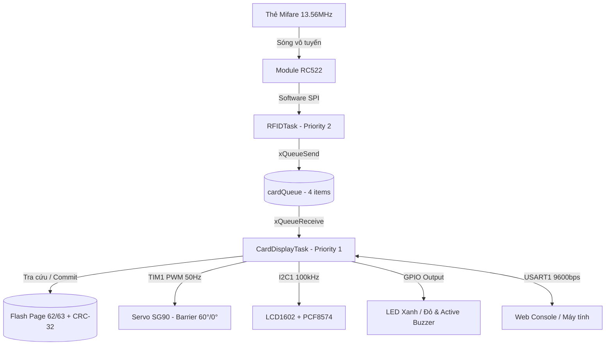
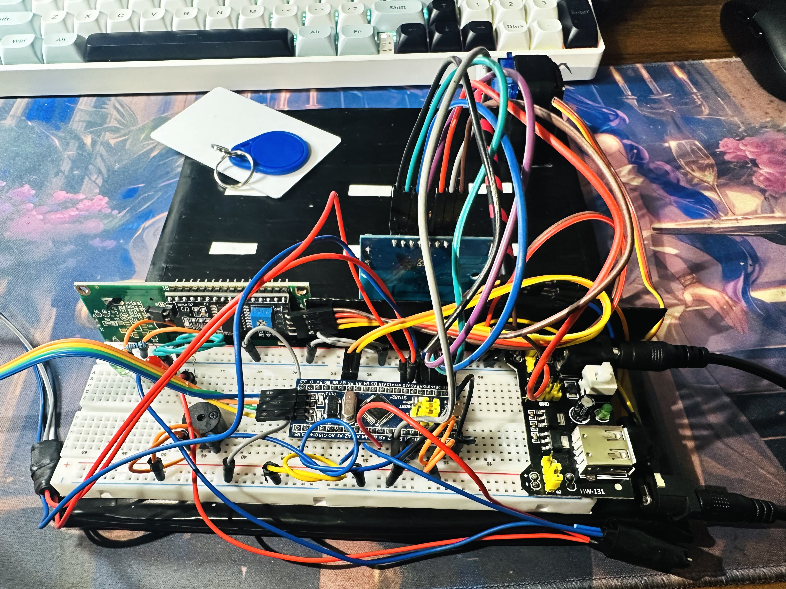

# Hệ Thống Kiểm Soát Ra Vào Bằng Thẻ RFID (STM32 & FreeRTOS)

Dự án xây dựng mô hình kiểm soát ra vào (Access Control) tự động ứng dụng vi điều khiển **STM32F103C8T6**, module đọc thẻ **RFID RC522 (13.56 MHz)** và hệ điều hành thời gian thực **FreeRTOS**. Hệ thống điều khiển cánh tay barrier bằng động cơ **Servo SG90**, hiển thị trạng thái qua **LCD1602 (I2C)**, đèn LED và còi báo động **Active Buzzer**, đồng thời hỗ trợ giám sát và điều hành thời gian thực qua giao diện **Web Serial Console (UART)**.

---

## 1. Giới thiệu dự án (Overview)

Trong các khu vực như bãi giữ xe thông minh, cổng kiểm soát tòa nhà hoặc phòng lab, việc xác thực quyền truy cập tự động giúp nâng cao mức độ an ninh và tối ưu hóa vận hành. Dự án này triển khai một giải pháp nhúng hoàn chỉnh trên vi điều khiển STM32 với các mục tiêu kỹ thuật cốt lõi:
- Nhận diện thẻ RFID không tiếp xúc chuẩn ISO/IEC 14443A, xác thực mã UID với danh sách thẻ cấp quyền (Whitelist).
- Điều khiển cơ cấu rào chắn barrier đóng/mở tự động với độ phản hồi nhanh và chính xác.
- Vận hành tin cậy nhờ kiến trúc đa nhiệm FreeRTOS, bảo vệ dữ liệu Whitelist trong bộ nhớ Flash nội và giám sát trực quan qua máy tính.

---

## 2. Chức năng chính (Features)

- **Nhận diện thẻ RFID:** Đọc mã định danh duy nhất (UID) của thẻ Mifare Classic 1K tần số 13.56 MHz ở cự ly 2–5 cm. Thuật toán Debounce (400 ms khoảng lặng và 8 chu kỳ vắng mặt) chống quét lặp khi thẻ đặt cố định trên đầu đọc.
- **Xác thực quyền truy cập:** Tra cứu mã UID trong danh sách Whitelist (hỗ trợ tối đa 3 thẻ đồng thời).
- **Điều khiển barrier tự động:** Khi thẻ hợp lệ, động cơ Servo nâng barrier mở góc 60°, duy trì mở 2.5 giây rồi tự động hạ về 0° và ngắt xung PWM (`CCR1 = 0`) chống rung giật cơ học và giảm nhiệt cho động cơ.
- **Phản hồi trực quan đa kênh:**
  - *Hợp lệ:* LED Xanh bật sáng, còi phát 1 tiếng bíp ngắn (90 ms), LCD hiển thị lời chào đón tiếp.
  - *Không hợp lệ:* LED Đỏ bật sáng, còi phát 2 tiếng bíp từ chối, LCD hiển thị lý do từ chối.
  - *Cảnh báo sai 3 lần liên tiếp:* Còi phát 3 hồi dồn dập, LED Đỏ sáng, LCD báo `WARNING` trong 750 ms, truyền log `ALERT` qua UART, tự động đặt lại bộ đếm về 0 mà không khóa hệ thống vĩnh viễn.
- **Lưu trữ Flash bền vững:** Quản lý danh sách thẻ bằng cơ chế **Two-Page A/B Ping-Pong** (Page 62 & 63) kết hợp mã kiểm tra **CRC-32 IEEE 802.3**, đảm bảo phục hồi dữ liệu an toàn khi mất nguồn đột ngột.
- **Giám sát & Quản trị UART:** Hỗ trợ tập lệnh điều khiển hai chiều và giao diện Web Serial Console (`uart_web.html`) trực tiếp trên trình duyệt máy tính.

---

## 3. Kiến trúc hệ thống (System Architecture)

### 3.1. Đa nhiệm thời gian thực với FreeRTOS
Firmware được tổ chức thành 2 tác vụ độc lập chạy trên nhân FreeRTOS Kernel V10.x:
- **`RFIDTask` (Priority 2, chu kỳ 50 ms):** Quét module RC522 qua Software SPI, xử lý chống dội thẻ, đóng gói sự kiện `AppCardEvent` gửi vào hàng đợi `cardQueue`.
- **`CardDisplayTask` (Priority 1):** Chờ nhận sự kiện từ `cardQueue`, tra cứu Whitelist, điều khiển Servo, cập nhật LCD, còi, LED và phân tích lệnh UART từ Ring Buffer.
- **Đồng bộ và bảo vệ tài nguyên:** Sử dụng `rc522Mutex` bảo vệ phần cứng đọc thẻ và `uartMutex` bảo vệ truyền dữ liệu Serial.



---

## 4. Sơ đồ kết nối phần cứng (Hardware Connections)

Hệ thống sử dụng module nguồn **HW-131** kết hợp nguồn ngoài để phân tách thành 3 nhánh độc lập nhằm loại bỏ hiện tượng sụt áp nguồn (Brownout Reset) khi Servo khởi động, đồng thời nối chung toàn bộ Mass (**Common GND**):

| Chân STM32 | Ngoại vi kết nối | Chuẩn giao tiếp / Chế độ | Chức năng chi tiết |
| :--- | :--- | :--- | :--- |
| **PB12** | RC522 (SDA/NSS) | GPIO Output Push-Pull | Chọn chip (CS) Software SPI |
| **PB13** | RC522 (SCK) | GPIO Output Push-Pull | Xung clock Software SPI |
| **PB14** | RC522 (MISO) | GPIO Input Floating | Dữ liệu Master In Slave Out |
| **PB15** | RC522 (MOSI) | GPIO Output Push-Pull | Dữ liệu Master Out Slave In |
| **PB0** | RC522 (RST) | GPIO Output Push-Pull | Reset phần cứng module RC522 |
| **PB6** | LCD1602 (SCL) | I2C1 Open-Drain (100 kHz) | Xung clock bus I2C PCF8574 (địa chỉ `0x27`) |
| **PB7** | LCD1602 (SDA) | I2C1 Open-Drain (100 kHz) | Dữ liệu bus I2C PCF8574 |
| **PA8** | Servo SG90 (Signal) | TIM1_CH1 PWM (50 Hz) | Xung điều khiển góc mở 60° / đóng 0° |
| **PB10** | Active Buzzer (+) | GPIO Output Push-Pull | Mức logic 3.3V kích còi bíp (cực âm nối GND) |
| **PA4** | LED Xanh (+) | GPIO Output Push-Pull | Báo hợp lệ / mở barrier (cực âm qua trở nối GND) |
| **PA5** | LED Đỏ (+) | GPIO Output Push-Pull | Báo từ chối / khóa an ninh (cực âm qua trở nối GND) |
| **PA9 / PA10**| CP2102 (RX / TX) | USART1 (9600 bps, 8-N-1) | Truyền nhận dữ liệu nối tiếp với máy tính |
| **3.3V / 5.0V**| HW-131 & Nguồn ngoài | Cấp nguồn độc lập | 3.3V cho STM32 & RC522; 5V cho LCD; Nguồn ngoài 5V/2A cho Servo |

<p align="center">
  
</p>
<p align="center"><em>Hình: Đấu nối dây phần cứng thực tế giữa STM32 và các module</em></p>

---

## 5. Tập lệnh điều khiển qua UART (UART Commands)

Hệ thống giao tiếp qua cổng nối tiếp USART1 với tốc độ **9600 bps** (khung truyền 8-N-1, ký tự kết thúc `\r\n`):

| Lệnh | Cú pháp | Chức năng thực tế |
| :--- | :--- | :--- |
| **HELP** | `HELP` | Trả về danh sách các câu lệnh hệ thống hỗ trợ |
| **STATUS** | `STATUS` | Xem trạng thái an ninh, số thẻ Whitelist, số log, trạng thái vắng mặt |
| **LIST** | `LIST` | Liệt kê toàn bộ các mã thẻ UID 4-byte hiện có trong Flash |
| **ADD** | `ADD <UID>` | Thêm thẻ thủ công vào Flash (Ví dụ: `ADD 62:99:18:02` hoặc `ADD 62991802`) |
| **DEL** | `DEL <UID>` | Xóa thẻ khỏi Flash theo mã UID (Ví dụ: `DEL 62:99:18:02`) |
| **ENROLL** | `ENROLL` | Bật chế độ tự động học thẻ trong 10s: Quẹt thẻ mới vào RC522 để lưu |
| **OPEN** | `OPEN` / `BARRIER OPEN` | Mở barrier thủ công (mở 2.5s rồi tự động đóng về 0°) |
| **CLOSE** | `CLOSE` / `BARRIER CLOSE` | Cưỡng bức hạ barrier về vị trí đóng 0° ngay lập tức |
| **LOCK** | `LOCK` | Khóa an ninh hệ thống: Ngừng quét RFID, đóng rào chắn, bật LED đỏ |
| **UNLOCK** | `UNLOCK` | Gỡ khóa an ninh, đưa hệ thống trở lại hoạt động bình thường |
| **LOG** | `LOG` | Xem 10 sự kiện quẹt thẻ gần nhất trong bộ nhớ đệm RAM |
| **LOG CLEAR** | `LOG CLEAR` | Xóa sạch toàn bộ lịch sử quẹt thẻ |
| **BEEP** | `BEEP` | Kích hoạt còi phát 1 tiếng bíp kiểm tra |

---

## 6. Cấu trúc thư mục dự án (Project Structure)

```text
RFID-Based-Access-Control-System/
├── picture/                     # Thư mục chứa hình ảnh minh họa cho tài liệu
├── RFID/                        # Thư mục dự án gốc STM32CubeIDE
│   ├── Core/
│   │   ├── Inc/                 # Header khai báo ngoại vi, FreeRTOSConfig, app.h
│   │   └── Src/
│   │       ├── main.c           # Điểm khởi tạo phần cứng, Clock 72MHz và RTOS Tasks
│   │       ├── app.c            # Xử lý logic nghiệp vụ, Flash Ping-Pong, FSM, UART
│   │       ├── rc522.c          # Driver Software Bit-Banging SPI cho MFRC522
│   │       ├── SERVO.c          # Driver điều khiển PWM Timer 1 cho Servo SG90
│   │       ├── I2C_LCD.c        # Driver giao tiếp LCD1602 qua chip PCF8574
│   │       └── uart.c           # Driver UART1 kèm Ring Buffer nhận lệnh ngắt RXNE
│   ├── FreeRTOS/Source/         # Mã nguồn nhân hệ điều hành thời gian thực FreeRTOS v10.x
│   └── STM32F103C8TX_FLASH.ld   # Linker script định vị Flash 64KB và Page 62/63
├── uart_web.html                # Giao diện Web Serial Console chạy trực tiếp trên trình duyệt
├── diagram.json / wokwi.toml    # Cấu hình kiểm thử mô phỏng trên nền tảng Wokwi
└── README.md                    # Tài liệu hướng dẫn kỹ thuật dự án
```

---

## 7. Hướng dẫn cài đặt & Chạy dự án (Getting Started)

### 7.1. Yêu cầu môi trường
- **Phần mềm:** [STM32CubeIDE](https://www.st.com/en/development-tools/stm32cubeide.html) (khuyến nghị phiên bản 1.10.0 trở lên) tích hợp trình biên dịch GNU ARM Embedded Toolchain.
- **Trình duyệt:** Google Chrome hoặc Microsoft Edge (hỗ trợ Web Serial API để mở `uart_web.html`).
- **Phần cứng:** Mạch nạp ST-Link V2, board STM32F103C8T6 và cáp chuyển đổi USB-to-UART CP2102.

### 7.2. Biên dịch và nạp Firmware
1. Khởi động STM32CubeIDE, chọn `File` -> `Import...` -> `Existing Projects into Workspace`, duyệt chọn thư mục `RFID/`.
2. Kiểm tra cấu hình trong `RFID.ioc` và Linker Script `STM32F103C8TX_FLASH.ld`.
3. Nhấn `Project` -> `Build All` (Ctrl + B) để biên dịch chương trình. Xác nhận hoàn tất với **0 Errors, 0 Warnings**.
4. Kết nối mạch nạp ST-Link V2 vào STM32 qua 4 đường tín hiệu SWD: `3.3V`, `GND`, `SWCLK`, `SWDIO`.
5. Chọn `Run` -> `Run As` -> `STM32 Cortex-M C/C++ Application` để nạp firmware vào vi điều khiển.

### 7.3. Vận hành và Giám sát
- Cấp nguồn 5V ngoài cho Servo SG90 (đảm bảo đã nối chung Mass GND với board STM32). Nhấn nút `Reset` trên STM32.
- Màn hình LCD1602 hiển thị thông điệp chờ: `Quet the RFID / Moi quet the...`.
- Kết nối module USB-UART vào máy tính, mở tệp `uart_web.html` trên trình duyệt, nhấn **Connect**, chọn đúng cổng COM và tốc độ `9600 bps` để bắt đầu điều khiển và theo dõi sự kiện quẹt thẻ thời gian thực.

---

## 8. Đánh giá kiểm thử & Giới hạn hiện tại

- **Đã kiểm chứng thực tế:**
  - Nhận diện nhạy thẻ Mifare Classic 1K ở cự ly 2–5 cm; thuật toán Debounce chống quét lặp hoạt động chuẩn xác.
  - Phân tách 3 nhánh nguồn và nối chung Mass loại bỏ hoàn toàn hiện tượng sụt áp (Brownout Reset) khi Servo khởi động.
  - Bộ nhớ Flash Two-Page A/B khôi phục chính xác danh sách thẻ sau khi ngắt và cấp lại nguồn.
- **Giới hạn mô phỏng (Wokwi):**
  - Chạy tốt các lệnh UART, mô phỏng hiển thị LCD và quay servo ảo.
  - Xuất hiện thông báo `ERR,FLASH_TOO_SMALL` do thanh ghi vùng nhớ ảo trên Wokwi trả về dung lượng < 64 KB, firmware sẽ tự động chuyển sang danh sách thẻ trên RAM.
- **Hạn chế kỹ thuật:**
  - Whitelist nội bộ hiện cấu hình tối đa 3 thẻ UID 4-byte phục vụ quy mô thực nghiệm học phần.
  - Giao tiếp giám sát sử dụng cổng UART có dây, chưa tích hợp kết nối mạng không dây (Wi-Fi/Ethernet).

---

## 9. Thành viên thực hiện (Contributors)

Dự án được thực hiện bởi nhóm sinh viên học phần *Lập trình nhúng và thời gian thực* – Trường Đại học Công nghệ (ĐHQGHN):
- **Phạm Thành Nam** (Trưởng nhóm) – Phụ trách chung, thiết kế kiến trúc đa nhiệm FreeRTOS và logic nghiệp vụ.
- **Hồ Đức Toàn** – Thiết kế phần cứng, xử lý chống sụt áp / Common GND, lập trình driver ngoại vi và Web Console.
- **Cao Nguyễn Phát** – Khảo sát linh kiện, kiểm thử hệ thống và xây dựng tài liệu dự án.
- **Đoàn Thế Đức** – Chế tạo mô hình cơ khí rào chắn barrier và đề xuất giải pháp lưu trữ Flash.
